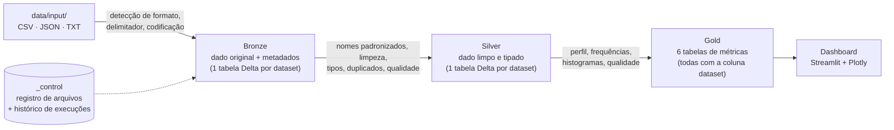

# Pipeline Lakehouse local (Spark + Delta Lake + Streamlit)

Projeto de Engenharia de Dados que roda **100% no seu computador**: você coloca arquivos
CSV, JSON ou TXT numa pasta, o pipeline (Apache Spark + Delta Lake) organiza tudo nas
camadas **Bronze → Silver → Gold** e um dashboard (Streamlit + Plotly) mostra os resultados.

Sem nuvem, sem Docker, sem serviços externos, sem APIs pagas e sem IA. Funciona no
Windows, Linux e macOS.

---

## Arquitetura (Medallion)



```
 data/input/          data/lakehouse/bronze/   data/lakehouse/silver/   data/lakehouse/gold/
 ┌────────────┐       ┌──────────────────┐     ┌───────────────────┐    ┌────────────────────┐
 │ clientes.csv│ ───► │ clientes/  (Delta)│ ──► │ clientes/  (Delta)│ ─► │ datasets_summary   │
 │ vendas.txt  │ ───► │ vendas/    (Delta)│ ──► │ vendas/    (Delta)│ ─► │ record_counts      │
 │ pedidos.json│ ───► │ pedidos/   (Delta)│ ──► │ pedidos/   (Delta)│ ─► │ column_profile     │ ─► dashboard.py
 │ ...         │      │ texto como veio + │     │ snake_case, tipos,│    │ value_frequencies  │
 └────────────┘       │ _source_file, ... │     │ _is_duplicate, ...│    │ numeric_histograms │
        │             └──────────────────┘     └───────────────────┘    │ quality_metrics    │
        └──── data/lakehouse/_control/file_registry  (evita ingestão duplicada)              └────────────────────┘
```

---

## Tutorial rápido

### 1) Instalar

**Pré-requisitos**

| Item | Versão | Observação |
|---|---|---|
| Python | 3.11 ou 3.12 | o PySpark 3.5 não suporta oficialmente o 3.13 |
| Java (JDK) | 8, 11, 17 ou 21, 64 bits | Java 22 ou mais novo **não** funciona com o Spark 3.5 |

Verifique o Java com `java -version`. Se o Java padrão da máquina for novo demais (ex.: 25),
não tem problema **desde que exista um JDK compatível instalado**: o pipeline procura
automaticamente nas pastas usuais (`C:\Program Files\Java`, Eclipse Adoptium, Microsoft,
Zulu, Corretto, `/usr/lib/jvm`, `/Library/Java/JavaVirtualMachines`, SDKMAN...) e usa o
primeiro compatível (preferência: 17, 21, 11, 8). Também é possível fixar o caminho em
`config/settings.yaml` → `spark.java_home`. Se não houver nenhum, instale um JDK 17
(por exemplo, Eclipse Temurin).

**Criar o ambiente virtual e instalar as dependências**

Windows (PowerShell):

```powershell
py -3.11 -m venv .venv
.\.venv\Scripts\Activate.ps1
python -m pip install -r requirements.txt
```

Linux / macOS:

```bash
python3.11 -m venv .venv
source .venv/bin/activate
python -m pip install -r requirements.txt
```

> Na **primeira** execução do pipeline o Spark baixa os JARs do Delta Lake (~6 MB) do
> Maven Central. Depois disso tudo funciona offline.

### 2) Colocar os arquivos em `data/input/`

Para testar com dados de exemplo:

```bash
python generate_sample_data.py
```

Isso cria 6 arquivos fictícios: `clientes.csv` (vírgula), `estoque_filial.csv` (`;` e
Windows-1252), `vendas.txt` (delimitado por `|`), `pedidos.json` (array JSON com objetos
aninhados), `sensores.json` (JSON Lines) e `log_sistema.txt` (texto livre). Eles têm, de
propósito, nulos em vários formatos, espaços sobrando, duplicados, decimais no padrão
brasileiro e uma linha malformada.

### 3) Rodar o pipeline

```bash
python pipeline.py
```

O terminal mostra cada etapa da arquitetura com as contagens (exemplo resumido):

```
[Etapa 1/5] Descoberta de arquivos em data/input
  6 arquivo(s) suportado(s) encontrado(s)
[Etapa 2/5] Ingestão -> Bronze (dado bruto + metadados de origem)
  novo       clientes.csv -> bronze/clientes: 124 linhas, 11 colunas [csv, delimitador ',', UTF-8]
  novo       estoque_filial.csv -> bronze/estoque_filial: 42 linhas, 6 colunas [csv, delimitador ';', windows-1252]
  ...
[Etapa 3/5] Silver (limpeza, tipos, duplicatas, qualidade)
  silver/clientes: 124 linhas | 4 duplicadas | 7 com problemas de qualidade
             tipos: id_cliente=bigint, codigo=string, ..., data_de_cadastro=date, ativo=boolean, saldo_r=double
  ...
[Etapa 4/5] Gold (métricas genéricas para o dashboard)
  clientes: datasets_summary=1, record_counts=1, column_profile=11, value_frequencies=67, ...
[Etapa 5/5] Controle (registro de arquivos e histórico)
  6 arquivo(s) no registro desta execução | status: SUCESSO
=== Resumo: 6 encontrados | 6 processados | 0 ignorados | 0 com falha | 68.9s ===
```

Rodando de novo sem mudar nada, a Etapa 2 mostra `pulado` para cada arquivo (nada é
duplicado). O log completo fica em `data/logs/`.

### 4) Abrir o dashboard

```bash
streamlit run dashboard.py
```

Acesse o endereço mostrado no terminal (normalmente `http://localhost:8501`). Se rodar o pipeline de novo com o dashboard
aberto, ele detecta a nova versão das tabelas na próxima interação; o botão
**Recarregar dados** força a releitura.

### 5) Ver os dados

No dashboard:

- **Visão geral**: datasets, registros, colunas por tipo, % de duplicados e de problemas.
- **Explorar dataset**: tipos inferidos, nulos, distintos, estatísticas numéricas e gráficos
  automáticos por coluna (histograma + box plot para numéricas, barras para categóricas e
  texto, linha do tempo para datas). Escolha o dataset e as colunas.
- **Qualidade**: métricas de qualidade por linha e por coluna e as linhas com problemas.
- **Arquivos processados**: registro de cada arquivo (status, hash, opções de leitura
  detectadas, erros) e histórico de execuções.
- **Camadas (Bronze/Silver/Gold)**: prévia de qualquer tabela, com escolha de colunas.

As tabelas ficam em `data/lakehouse/` no formato Delta (Parquet + `_delta_log`) e podem ser
lidas por qualquer ferramenta compatível com Delta (Spark, `deltalake`, DuckDB...).

---

## Usando seus próprios dados

1. Apague (ou mantenha) os arquivos de exemplo em `data/input/`.
2. Copie seus arquivos `.csv`, `.json`, `.jsonl` ou `.txt` para `data/input/` (subpastas também são lidas).
3. Rode `python pipeline.py`.

Não é preciso editar código Python. O formato vem da extensão; delimitador, codificação,
modo do TXT e formato do JSON são detectados automaticamente. Quando a detecção não
servir, ajuste em `config/settings.yaml` (veja abaixo). Outras extensões (ex.: `.xlsx`)
são ignoradas com um aviso no log.

**Nome do dataset**: vem do nome do arquivo em snake_case (`Vendas 2024.csv` → `vendas_2024`).
Arquivos com o mesmo nome e extensões diferentes (`clientes.csv` e `clientes.json`) vão
para o **mesmo** dataset; use a opção `dataset` para separá-los ou para juntar vários
arquivos numa mesma tabela.

### Configurar leitura (`config/settings.yaml`)

Os padrões ficam em `read_defaults`. Ajustes por arquivo ficam em `files`, usando o nome
do arquivo ou um padrão glob. Exemplo:

```yaml
files:
  "relatorio.txt":
    mode: delimited      # TXT tabular
    delimiter: ";"
  "notas.txt":
    mode: plain          # TXT livre: uma linha = um registro (coluna "linha")
  "export_*.csv":
    encoding: latin-1
    header: false        # colunas viram coluna_1, coluna_2, ...
    dataset: exportacoes # todos os export_*.csv numa tabela só
  "eventos.json":
    multiline: false     # JSON Lines
```

Opções aceitas por arquivo: `encoding`, `delimiter`, `header`, `quote`, `escape`,
`multiline`, `mode` (só TXT) e `dataset`. Uma opção desconhecida gera erro com a lista das
válidas.

**Delimitadores (CSV e TXT)**

- `delimiter: auto` testa `,` `;` tabulação e `|` nas primeiras linhas (amostra de 256 KB) e
  escolhe o que produz o número de colunas mais consistente (respeitando aspas).
- Valores aceitos: qualquer caractere (`";"`, `"#"`...), `"\t"`, ou os apelidos `tab`,
  `pipe`, `semicolon`, `comma`, `space`.

**TXT**

- `mode: auto`: se ≥ 90% das linhas da amostra tiverem o mesmo número (≥ 2) de colunas com
  um dos delimitadores candidatos, o arquivo é lido como tabela; senão, como texto livre.
- `mode: delimited`: sempre tabela (com `delimiter` informado ou detectado).
- `mode: plain`: sempre texto livre, uma linha por registro, na coluna `linha`.

**JSON**

- `multiline: auto` (padrão): arquivo que começa com `[` ou um objeto espalhado em várias
  linhas é lido como JSON "multilinha"; se a primeira linha já é um objeto completo, é lido
  como **JSON Lines** (um objeto por linha).
- `multiline: true` força array/multilinha; `multiline: false` força JSON Lines.

**Codificação**

`encoding: auto` usa UTF-8 (com ou sem BOM) e, se o arquivo não for UTF-8 válido, assume
Windows-1252 (comum em CSV exportado do Excel no Brasil). Também aceita `latin-1`,
`windows-1252`, `utf-16` etc.

Para usar outro arquivo de configuração: `python pipeline.py --config caminho.yaml` (ou a
variável de ambiente `LAKEHOUSE_CONFIG`, que também vale para o dashboard).

### Reprocessamento

O pipeline guarda em `data/lakehouse/_control/file_registry` o caminho e o hash SHA-256 de
cada arquivo:

| Situação | O que acontece |
|---|---|
| arquivo novo | é processado |
| mesmo nome, conteúdo alterado | é processado e **substitui** os dados anteriores dele |
| já processado e sem mudança | é ignorado (sem duplicar dados) |
| falhou na última tentativa | é tentado de novo |

Comandos:

```bash
python pipeline.py --reprocess vendas.txt          # força um (ou mais) arquivo(s)
python pipeline.py --reprocess a.csv b.json
python pipeline.py --reprocess-all                 # força todos os arquivos de data/input
python pipeline.py --full-refresh                  # apaga bronze/silver/gold/_control e refaz tudo
```

Reprocessar nunca duplica linhas: a Bronze substitui, numa única transação Delta
(`replaceWhere`), apenas as linhas daquele arquivo; Silver e Gold do dataset são recalculadas.
Se um arquivo que já tinha sido carregado falhar ao ser reprocessado, os dados da versão
anterior são mantidos e o erro fica no registro. Arquivos removidos de `data/input` **não**
são apagados do lakehouse; use `--full-refresh` para limpar.

---

## O que cada camada faz

### Bronze — `data/lakehouse/bronze/<dataset>`

- Uma tabela Delta por dataset (os arquivos têm schemas diferentes; tabelas separadas são
  mais simples de consultar e evoluir). Vários arquivos no mesmo dataset são unidos por nome
  de coluna (`mergeSchema`).
- CSV/TXT: todas as colunas como texto, exatamente como vieram (nada é convertido aqui).
- JSON: estrutura preservada (objetos aninhados e arrays), valores como texto.
- Nomes de coluna: só os caracteres que o Delta não aceita (espaço, `,;{}()=.`) viram `_`.
- Registros malformados (ex.: linha com colunas a mais) ficam na coluna `_corrupt_record`.
- Metadados por linha: `_source_file`, `_source_path`, `_source_size_bytes`, `_source_hash`,
  `_source_format`, `_ingestion_timestamp`, `_batch_id`, `_record_id`.

### Silver — `data/lakehouse/silver/<dataset>`

- Achata objetos JSON (`cliente.endereco.cidade` → `cliente_endereco_cidade`); arrays viram texto JSON.
- Nomes em snake_case, sem acentos e únicos (`Preço Unitário (R$)` → `preco_unitario_r`).
- Remove espaços nas bordas; vazios e tokens como `NULL`, `N/A`, `-`, `nan` viram nulo
  (lista configurável em `silver.null_tokens`).
- Infere tipos (inteiro, decimal com ponto ou vírgula, data, data/hora, booleano) somente
  quando ≥ 95% dos valores não nulos convertem (`silver.type_inference_threshold`).
- `_is_duplicate` = `true` a partir da 2ª ocorrência de uma linha idêntica (em todas as
  colunas de dados) e `_duplicate_count` = tamanho do grupo. **Nada é removido.**
- `_quality_issues` lista os problemas da linha (`linha_duplicada`, `linha_vazia`,
  `registro_malformado`, `tipo_invalido:coluna=valor original`) e `_has_quality_issues` resume.

### Gold — `data/lakehouse/gold/<tabela>` (genérica, sem regras de negócio)

| Tabela | Conteúdo |
|---|---|
| `datasets_summary` | arquivos, registros, colunas por tipo, duplicados, linhas com problemas, completude |
| `record_counts` | registros, duplicados e problemas por arquivo de origem |
| `column_profile` | tipo, categoria, regra de inferência, nulos (qtd/%), distintos, mín/máx, média, desvio, quartis, tamanho de texto |
| `value_frequencies` | valores mais frequentes (top 15) de colunas categóricas, booleanas, texto e numéricas com poucos valores |
| `numeric_histograms` | faixas (20 bins) com contagem para cada coluna numérica |
| `quality_metrics` | por coluna: nulos, nulos padronizados, espaços removidos, falhas de conversão; por linha: duplicadas, vazias, malformadas |

### Controle — `data/lakehouse/_control/`

- `file_registry`: um registro por arquivo (hash, status `SUCESSO`/`FALHA`, motivo, linhas,
  opções de leitura usadas, avisos, erro).
- `pipeline_runs`: histórico de execuções.

---

## Windows sem winutils.exe

No Windows o Hadoop (usado pelo Spark) normalmente exige `winutils.exe`/`HADOOP_HOME`
para gravar arquivos. **Este projeto não precisa disso**: quando o winutils não está
instalado, ele ativa automaticamente um modo compatível:

- `HADOOP_HOME` aponta para uma pasta vazia em `.cache/hadoop` (só para o Hadoop iniciar);
- o sistema de arquivos local do Hadoop é trocado por `BareLocalFileSystem`
  (`tools/windows/src/.../BareLocalFileSystem.java`, ~100 linhas), que apenas ignora
  `chmod`/`chown`, operações sem efeito prático num lakehouse local no Windows;
- o JAR compilado já vem em `tools/windows/bare-local-fs.jar`; se for apagado, é recompilado
  na hora com o `javac` do JDK;
- os JARs do Delta vão para `.cache/jars` (baixados pelo Ivy incluído no PySpark).

Se você já tem o winutils configurado (`HADOOP_HOME\bin\winutils.exe`), o projeto usa o
caminho padrão do Spark. Nada é instalado no sistema: as variáveis de ambiente são ajustadas
só dentro do processo do pipeline.

---

## Estrutura do projeto

```
pipeline-lakehouse/
├── pipeline.py                 # CLI do pipeline
├── dashboard.py                # app Streamlit
├── generate_sample_data.py     # gera arquivos de exemplo
├── config/
│   ├── settings.yaml           # configuração (leitura, Silver, Gold, Spark)
│   └── log4j2.properties       # silencia logs ruidosos da JVM
├── lakehouse/
│   ├── config/settings.py      # carga da configuração + ajustes por arquivo
│   ├── ingestion/              # detecção (encoding, delimitador, TXT, JSON), leitura Spark, registro
│   ├── bronze/writer.py        # gravação por arquivo com replaceWhere
│   ├── silver/                 # limpeza, inferência de tipos, duplicados, qualidade
│   ├── gold/                   # métricas genéricas
│   ├── dashboard/data.py       # leitura Delta via deltalake (sem Spark)
│   ├── utils/                  # SparkSession, Java, nomes, logging, Delta I/O
│   ├── constants.py            # nomes das colunas técnicas e das tabelas
│   └── pipeline.py             # orquestração: Etapas 1 a 5, na ordem
├── .streamlit/config.toml      # desliga as estatísticas de uso do Streamlit (100% local)
├── tools/windows/              # BareLocalFileSystem (Windows sem winutils)
├── tests/                      # pytest
└── data/
    ├── input/                  # SEUS ARQUIVOS AQUI
    ├── lakehouse/              # bronze/ silver/ gold/ _control/ (gerado)
    └── logs/                   # logs das execuções (gerado)
```

## Roteiro sugerido para o vídeo

1. **Arquitetura**: o diagrama Medallion no início deste README.
2. **Entrada**: `python generate_sample_data.py` e os arquivos em `data/input/` (mostre o
   `estoque_filial.csv` com `;` e o `log_sistema.txt` em texto livre).
3. **Configuração**: `config/settings.yaml` (padrões de leitura e a seção `files:` de ajustes por arquivo).
4. **Orquestração**: `lakehouse/pipeline.py`, função `run_pipeline` (as 5 etapas em sequência).
5. **Camadas no código**: `ingestion/detection.py` → `ingestion/reader.py` → `bronze/writer.py`
   → `silver/transform.py` (+ `type_inference.py`) → `gold/metrics.py`.
6. **Execução**: `python pipeline.py` e o log por etapa; depois rode de novo para mostrar
   os arquivos pulados e `python pipeline.py --reprocess vendas.txt`.
7. **Resultado em disco**: `data/lakehouse/` (pastas Parquet + `_delta_log`).
8. **Dashboard**: `streamlit run dashboard.py`, passando pelas páginas Visão geral,
   Explorar dataset, Qualidade, Arquivos processados e Camadas.

---

## Testes

```bash
python -m pytest
```

Inclui testes de normalização de nomes, detecção de delimitador/encoding/formato,
configuração, inferência de tipos (Spark), um pipeline ponta a ponta num lakehouse
temporário (ingestão, reexecução sem duplicar, `--reprocess`, arquivo alterado, arquivo
JSON inválido) e o dashboard executado com o `AppTest` do Streamlit.

---

## Limitações conhecidas

**Inferência de schema e tipos**

- Delimitador, cabeçalho e formato do JSON são decididos com base no início do arquivo
  (256 KB). Um arquivo cujo início não representa o resto pode ser mal detectado; nesse caso
  configure em `settings.yaml`.
- Não há detecção automática de cabeçalho: o padrão é `header: true`.
- Os tipos são inferidos sobre todos os valores, mas de forma conservadora: colunas mistas
  ficam como texto; números com zero à esquerda (`00123`) continuam texto (códigos);
  inteiros com mais de 18 dígitos continuam texto.
- `1.234` é lido como 1,234 (ponto decimal) a menos que a coluna tenha valores com vírgula
  decimal (`1.234,56`), quando o padrão brasileiro é usado.
- Datas ambíguas como `03/04/2024` são lidas como dia/mês (padrão brasileiro); o formato
  mês/dia só é usado quando converte mais valores da coluna (ex.: `12/25/2024`).
- Com o limiar de 95%, até 5% dos valores de uma coluna podem não converter: eles ficam nulos
  na Silver, aparecem em `_quality_issues` com o valor original e continuam intactos na Bronze.
  Use `type_inference_threshold: 1.0` para só converter colunas 100% válidas.
- No CSV, campos vazios sem aspas já chegam como nulo na Bronze (comportamento do leitor
  CSV do Spark).

**TXT**

- O modo `auto` só reconhece os delimitadores `,` `;` tabulação e `|`. Outros precisam ser
  configurados. Texto livre em que todas as linhas têm o mesmo número de vírgulas pode ser
  confundido com tabela: use `mode: plain`.
- Arquivos de largura fixa (colunas por posição) não são suportados.
- No modo texto livre cada linha é um registro; não há parsing de padrões (ex.: logs).

**JSON**

- Objetos aninhados viram colunas na Silver; arrays viram texto JSON (não são "explodidos").
- Um JSON multilinha (array) é lido por uma única tarefa do Spark; arquivos muito grandes
  devem preferir JSON Lines.

**Gerais**

- Desempenho de máquina local: o Spark leva ~10 s para iniciar e os arquivos de exemplo
  levam cerca de 1 minuto no total. Para arquivos muito grandes, ajuste `spark.driver_memory`.
- A contagem de distintos é exata até 50 milhões de células por dataset; acima disso é
  aproximada (indicado em `distinct_is_approx`). Box plots e linha do tempo do dashboard usam
  até 200 mil linhas da Silver.
- Duplicados consideram linhas idênticas dentro do mesmo dataset (inclusive entre arquivos).
- Testado neste ambiente: Windows 11, Python 3.11, JDK 21. Em Linux/macOS o projeto usa o
  caminho padrão do Spark (`configure_spark_with_delta_pip`), que não foi executado aqui.

## Solução de problemas

- **"Nenhum Java compatível encontrado"**: instale um JDK 17 (ou 11/21) de 64 bits ou configure
  `spark.java_home`.
- **Mensagens "ÊXITO: o processo com PID ... foi finalizado" no Windows**: normais; é o PySpark
  encerrando o processo Java ao final.
- **Pasta sincronizada pelo OneDrive/Dropbox**: a sincronização pode bloquear arquivos do
  `_delta_log` durante a gravação. Se aparecerem erros de acesso a arquivos, mova o projeto
  para uma pasta fora da sincronização.
- **Falha no download dos JARs do Delta na primeira execução**: é necessária internet uma
  única vez (Maven Central). Depois eles ficam em cache (`.cache/jars` no Windows sem
  winutils; `~/.ivy2` nos demais casos).
- **Um arquivo aparece com FALHA**: veja a mensagem na página *Arquivos processados* ou no log;
  normalmente basta ajustar `delimiter`, `encoding`, `mode` ou `multiline` em `settings.yaml`
  e rodar `python pipeline.py` de novo (arquivos com falha são tentados novamente).
